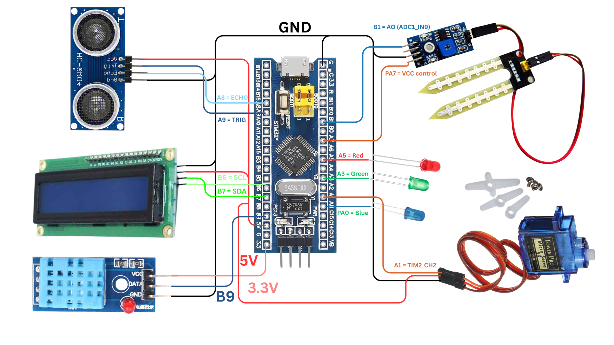
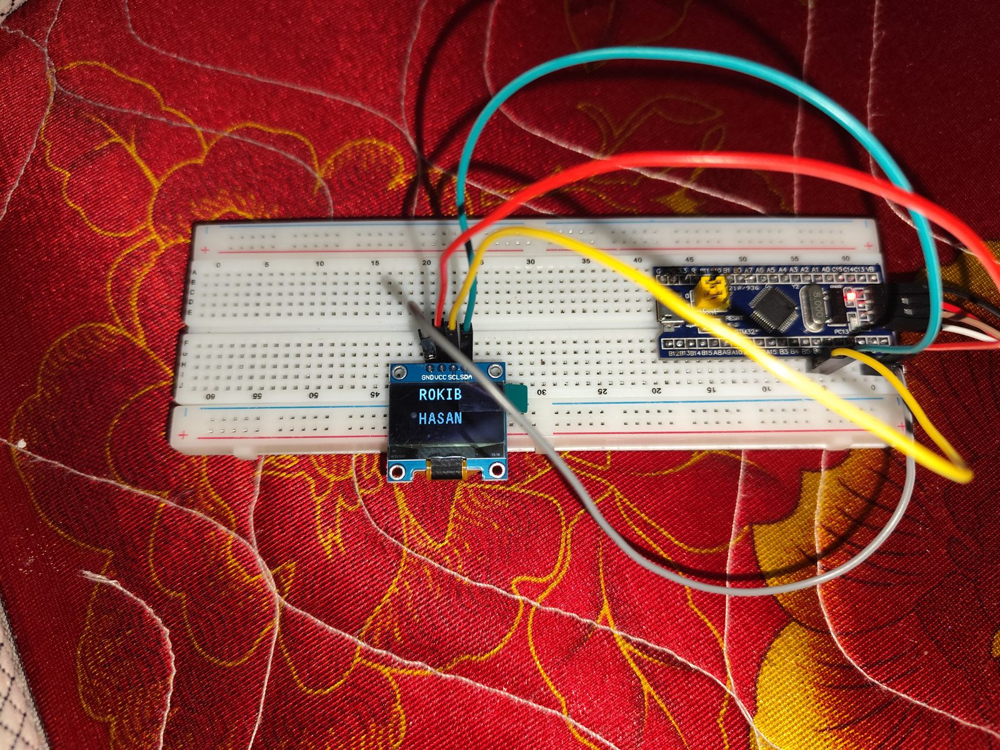

# CSE331L: Microprocessor Interfacing & Embedded Systems Lab


My complete lab work for **CSE331L** at **North South University** (Department of Electrical & Computer Engineering, Summer 2025, Section 8).

The course had two halves:

1. **ARM assembly** on the CPUlator ARMv7 simulator: registers, flags, memory, branching, loops, functions and memory-mapped I/O.
2. **Embedded C on real hardware**: an STM32F103C8T6 "Blue Pill" with GPIO, I²C displays, keypads, ADC sensors, timers and PWM.

It ended with a group project, the **Smart Greenhouse & Water Tank Manager**.



## Repository layout

```
.
├── assembly-labs/        ARM assembly labs 2–6: task sheets, submitted answers, corrected .s solutions
├── stm32-labs/           20 STM32CubeMX + Keil projects (GPIO → LCD → keypad → sensors → servo), OLED demo video + photos
├── greenhouse-project/   Final group project: firmware versions, reports, pin diagram
├── libraries/            Reusable drivers: I²C LCD (HD44780), SSD1306 OLED, DHT11
├── course-materials/     Lecture slides, lab manuals, hardware list
└── notes/                My class notes and mid-exam notes
```

## 1. ARM assembly labs → [`assembly-labs/`](assembly-labs)

| Lab | Topics |
|-----|--------|
| [Lab 2](assembly-labs/lab-02) | `MOV`, `ADD`, `SUB`, CPSR flags, `.data` variables, `LDR` / `STR`, `MUL` |
| [Lab 3](assembly-labs/lab-03) | Logical ops (`EOR`), shifts and rotates, divide by shifting, arrays |
| [Lab 4](assembly-labs/lab-04) | `CMP`, conditional branches, loops, functions (`BL` / `BX LR`) |
| [Lab 5](assembly-labs/lab-05) | if/else, array min/sum, Pythagoras check with LED + 7-segment output |
| [Lab 6](assembly-labs/lab-06) | Memory-mapped I/O: switches, push buttons, LEDs, seven-segment display |

Every task has a corrected, commented `.s` file you can paste into [CPUlator](https://cpulator.01xz.net/?sys=arm-de1soc).
The submitted answer sheets are kept unchanged, and the bugs found in them are listed in the [corrections table](assembly-labs/README.md#corrections).

## 2. STM32 hardware labs → [`stm32-labs/`](stm32-labs)

20 projects, in the order they were done:

- **GPIO**: LED on, blink, LED chaser
- **I²C 16×2 LCD**: text output
- **4×4 keypad**: EXTI interrupts, keys shown on the LCD
- **IR sensor**: ADC, distance bands
- **HC-SR04 ultrasonic**: distance with traffic-light LEDs
- **DHT11**: temperature and humidity
- **Soil-moisture sensor**: ADC readings
- **SSD1306 OLED**: graphics display
- **SG90 servo**: PWM control

See the [project table](stm32-labs/README.md) for details and [build instructions](stm32-labs/README.md#building-a-project).

## 3. Final project: Smart Greenhouse & Water Tank Manager → [`greenhouse-project/`](greenhouse-project)

Monitors air temperature and humidity (DHT11), soil moisture (ADC) and the water-tank level (HC-SR04). It shows everything on an I²C LCD with an RGB status LED, and opens a servo-driven irrigation valve when the soil is too dry or the tank level is out of range. The firmware includes alarm confirmation, sensor-health checks and a maintenance mode.

## Project gallery

The [OLED lab](stm32-labs/OLED/README.md) running on my breadboard: a Blue Pill driving a 0.96″ SSD1306 display over I²C. Click the first image to watch the demo video.

<p>
  <a href="stm32-labs/OLED/video/oled-demo.mp4"></a>
</p>
<p>
  
  
  
</p>

More photos: [OLED lab page](stm32-labs/OLED/README.md#photos)

## Hardware used

| # | Hardware | Type | Required | Example link |
|---|----------|------|----------|--------------|
| 1 | STM32F103C8T6 "Blue Pill" | MCU | Must | [RoboticsBD](https://store.roboticsbd.com/arduino-bangladesh/350-stm32f103c8t6-blue-pill-development-board-robotics-bangladesh.html) |
| 2 | ST-LINK V2 programmer / debugger | Programmer | Must | [RoboticsBD](https://store.roboticsbd.com/programmer/1102-st-link-stlink-st-link-v2-mini-stm8-stm32-simulator-download-programmer-robotics-bangladesh.html) |
| 3 | 16×2 I²C LCD *or* 0.96″ I²C OLED | Display | Must | [16×2 LCD](https://store.roboticsbd.com/arduino-shield-module/1349-16x2-serial-lcd-module-display-for-arduino-assembled-robotics-bangladesh.html) / [0.96″ OLED](https://store.roboticsbd.com/arduino-shield-module/1328-096-inch-i2c-oled-display-white-robotics-bangladesh.html) |
| 4 | 4×4 keypad matrix | Input | Must | [RoboticsBD](https://store.roboticsbd.com/arduino-shield-module/986-4x4-keypad-16-key-matrix-membrane-type-robotics-bangladesh.html) |
| 5 | DHT11 temperature & humidity sensor | Sensor | Must | [RoboticsBD](https://store.roboticsbd.com/sensors/2654-dht11-temperature-and-humidity-sensor-module-robotics-bangladesh.html) |
| 6 | HC-SR04 ultrasonic sensor | Sensor | Must | [RoboticsBD](https://store.roboticsbd.com/sensors/22-ultrasonic-sonar-sensor-hc-sr04-robotics-bangladesh.html) |
| 7 | SG90 servo (360° continuous) | Actuator | Must | [RoboticsBD](https://store.roboticsbd.com/motor/2450-servo-motor-micro-sg90-360-degree-continuous-rotation-robotics-bangladesh.html) |
| 8 | IR obstacle sensor | Sensor | Optional | [RoboticsBD](https://store.roboticsbd.com/sensors/685-infrared-obstacle-avoidance-ir-sensor-module-robotics-bangladesh.html) |
| 9 | YL-69 soil-moisture sensor | Sensor | Optional | [RoboticsBD](https://store.roboticsbd.com/sensors/145-yl-69-soil-hygrometer-humidity-soil-moisture-detection-sensor-robotics-bangladesh.html) |

Full list: [`course-materials/CSE331L-Hardware-Details.pdf`](course-materials/CSE331L-Hardware-Details.pdf)

## Software

| Tool | Used for | Download |
|------|----------|----------|
| STM32CubeMX | Pin / clock / peripheral setup and code generation | [st.com](https://www.st.com/en/development-tools/stm32cubemx.html) |
| Keil µVision 5 (MDK-ARM) | Compiling and debugging | [keil.com](https://www.keil.com/download/product/) |
| STM32 ST-LINK Utility | Flashing over ST-LINK | [st.com](https://www.st.com/en/development-tools/stsw-link004.html) |
| CPUlator | ARMv7 assembly simulator (in the browser) | [cpulator.01xz.net](https://cpulator.01xz.net/?sys=arm-de1soc) |

## Getting started

```bash
git clone https://github.com/Rokib-Hasan-Oli/CSE-331-Hardware-Practice-And-Test.git
```

- **Assembly**: open CPUlator, paste a file from `assembly-labs/lab-0N/solutions/`, then *Compile and Load* and *Continue*.
- **STM32**:
  1. Open the project's `.ioc` in STM32CubeMX and click **Generate Code**. This restores the `Drivers/` folder, which isn't stored in the repo.
  2. Build `MDK-ARM/*.uvprojx` in Keil.
  3. Flash it with ST-LINK.

## Course materials

- [Lecture slides](course-materials/lecture-slides): microprocessor basics and ARM assembly, parts 1–3
- [Lab manuals](course-materials/lab-manuals): Labs 2, 4, 5 and 6
- [My notes](notes): class notes 1–3 and mid-exam notes

Lecture slides and lab manuals belong to the course instructors and are included for reference.

## License

Educational use. You're free to use, modify and share the code.
