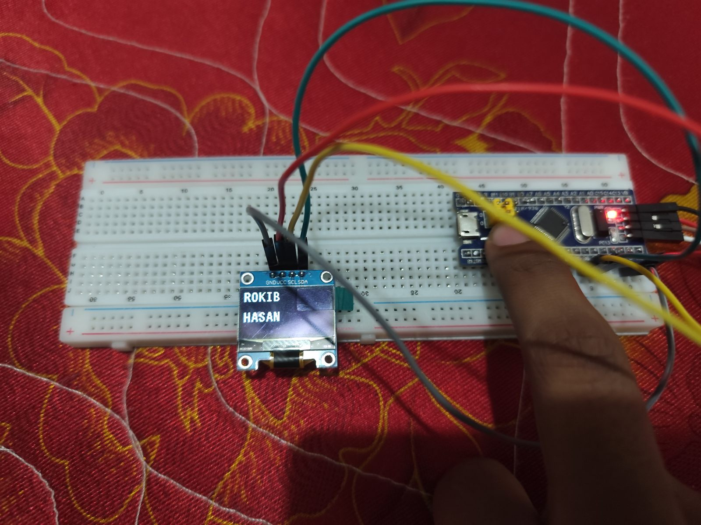
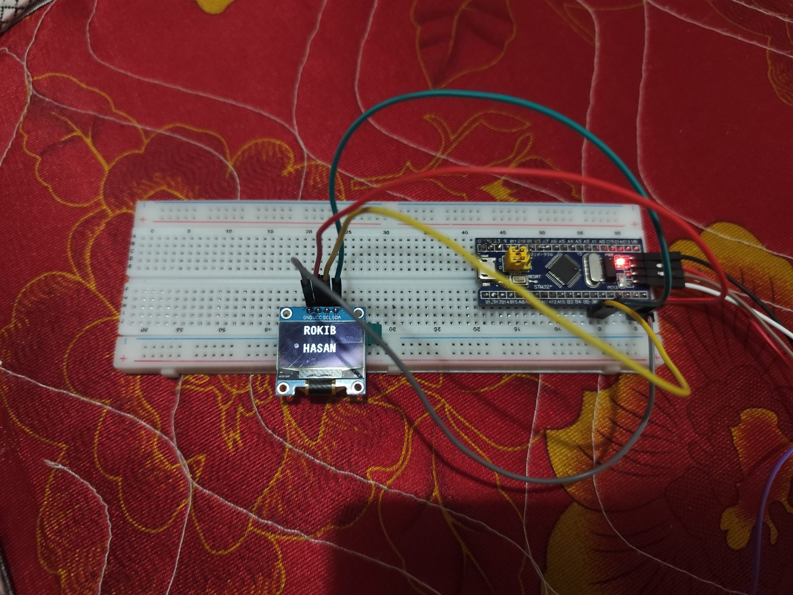
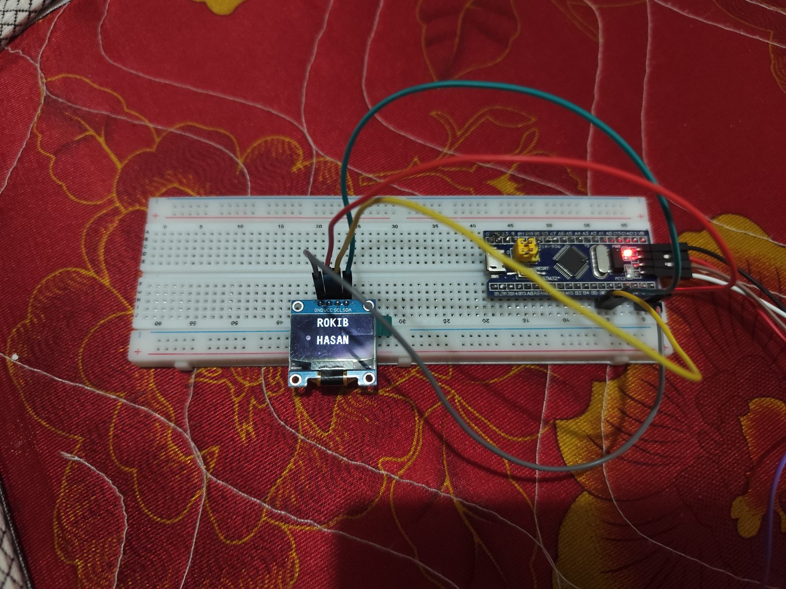
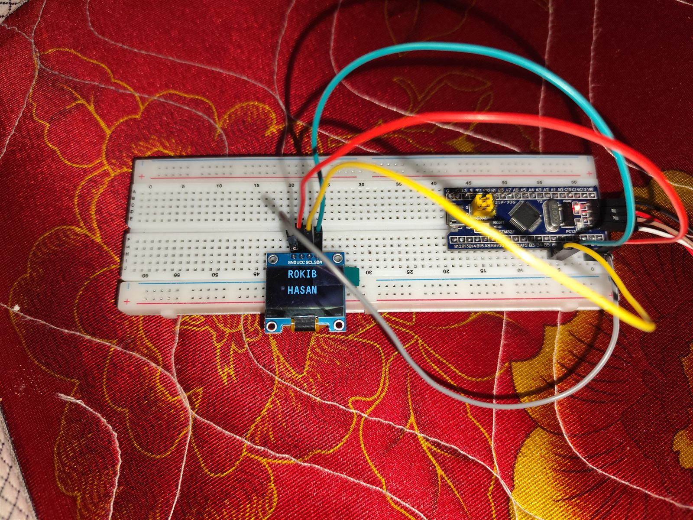
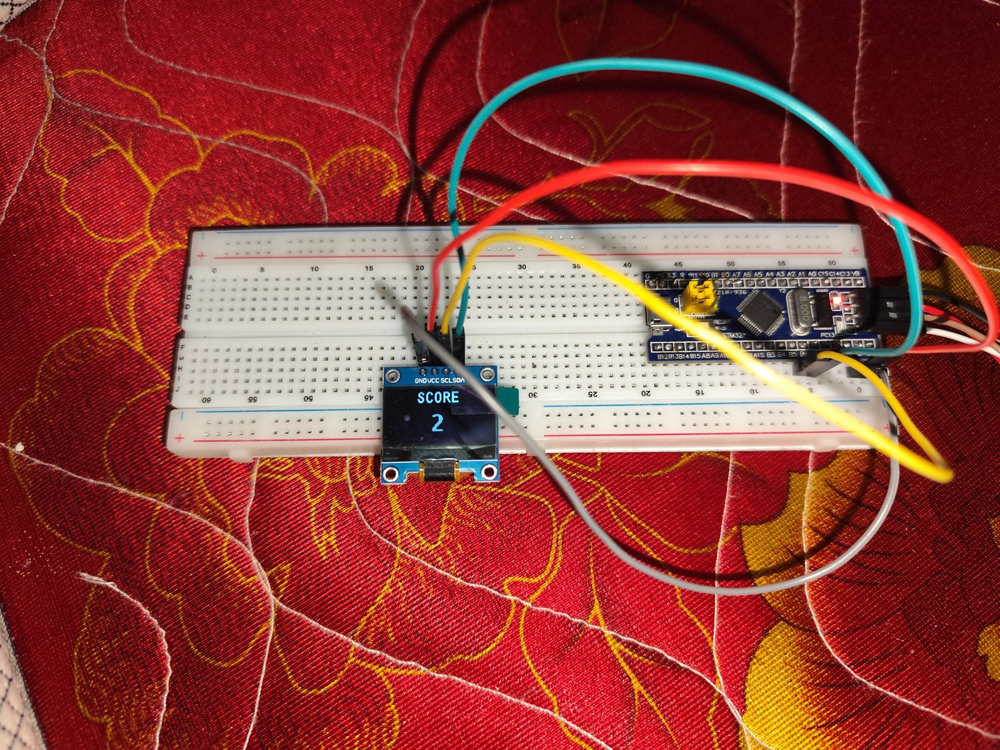

# OLED Lab: SSD1306 Display on the STM32 Blue Pill

Drives a **0.96″ 128×64 SSD1306 OLED** over **I²C** from an STM32F103C8T6 (Blue Pill).
The program shows my name, scrolls it right and then left, and then runs a **SCORE** counter.

*Click the image to open the demo video (MP4, 21 s, 720p). On GitHub, use **View raw** or the download button if it doesn't play in the browser.*

## What the program does

1. Initialises the display and prints **ROKIB / HASAN** (11×18 font).
2. Scrolls the screen right for 3 s, then left for 3 s, then stops scrolling.
3. Clears the screen, shows **SCORE**, and counts from 1 to 10000 (16×26 font, every 0.5 s), centring the number for 1, 2, 3 or 4+ digits.

## Wiring

| OLED pin | Blue Pill pin |
|----------|---------------|
| GND | GND |
| VCC | 3.3 V or 5 V (the module supports both) |
| SCL | PB6 (I2C1_SCL) |
| SDA | PB7 (I2C1_SDA) |

I2C1 runs in Fast mode (400 kHz). The display's I²C address is `0x78` (`0x3C` shifted), set in `ssd1306.h`.

## Photos

| | |
|:-:|:-:|
|  |  |
| Name screen | Name screen, close-up |
|  |  |
| Breadboard setup | Breadboard setup, wide |
|  |  |
| SCORE counter | Overhead view |
|  |  |
| Top view | SCORE counter, top view |

## Files

- `OLED.ioc`: STM32CubeMX configuration (I2C1 Fast mode, PB6/PB7)
- `Core/Src/main.c`: the program above
- `Core/Src/ssd1306.c`, `Core/Src/fonts.c`: SSD1306 driver and fonts (also in [`libraries/oled-ssd1306`](../../libraries/oled-ssd1306))
- `MDK-ARM/OLED.uvprojx`: Keil µVision project

To build it, see [Building a project](../README.md#building-a-project).

**Fix:** `snum` was declared as `char[5]`, but `"10000"` needs 6 bytes including the terminating NUL, so `sprintf` overflowed the buffer on the last count. It is now `char[6]`.
