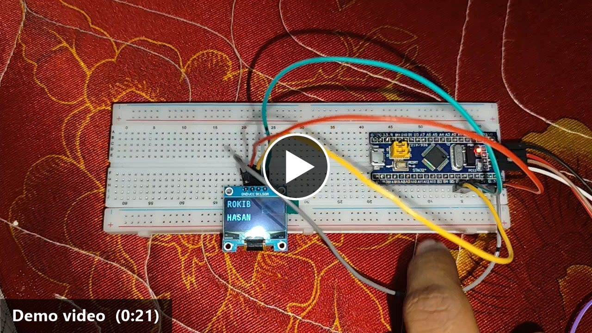
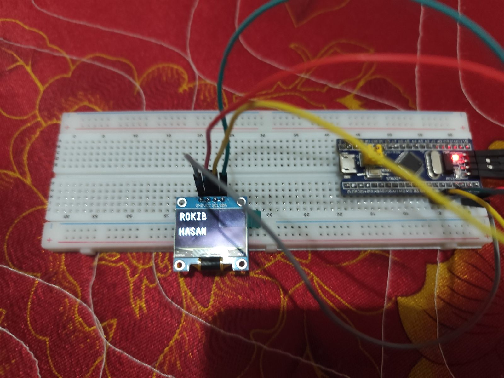
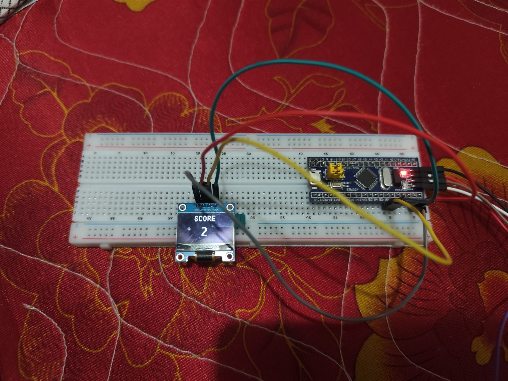

# STM32 Hardware Labs

Hands-on labs on the **STM32F103C8T6 "Blue Pill"**, configured with **STM32CubeMX**, built with **Keil µVision 5 (MDK-ARM)** and flashed with an **ST-LINK V2**.
Every folder is a complete CubeMX + Keil project (`.ioc`, `Core/`, `MDK-ARM/`), listed below in the order the course covered them.

| # | Project | Topic | Peripherals / pins | What it does |
|---|---------|-------|--------------------|--------------|
| 1 | [`CSE311Lab1`](CSE311Lab1) | GPIO output | PC13 | Turns on the on-board LED (PC13 is active-low) |
| 2 | [`CSE331Lab2`](CSE331Lab2) | GPIO output | PA7 | Turns on an external LED |
| 3 | [`CSE331Lab3`](CSE331Lab3) | GPIO + `HAL_Delay` | PA7 | Blinks the LED every second |
| 4 | [`CSE331Lab4`](CSE331Lab4) | GPIO sequencing | PA5–PA7 | Three-LED chaser, one step per second |
| 5 | [`CSE331Lab5`](CSE331Lab5) | GPIO input/output | PA8 in, PA9 out | CubeMX pin setup only (no application code) |
| 6 | [`Hello_LCD`](Hello_LCD) | I²C 16×2 LCD | I2C1 (PB6 SCL, PB7 SDA) | Prints "Hello ARM / LCD Working" |
| 7 | [`LCDTEST`](LCDTEST) | I²C 16×2 LCD | I2C1 | Prints "Hello / Rokib" |
| 8 | [`LCD_KeyPad`](LCD_KeyPad) | LCD + keypad | I2C1, GPIO | CubeMX setup only (no application code) |
| 9 | [`KeyPadTest`](KeyPadTest) | 4×4 keypad, EXTI | GPIO + EXTI | Detects key presses in the EXTI interrupt callback |
| 10 | [`LCD_4KeyPad`](LCD_4KeyPad) | Keypad → LCD | I2C1, GPIO + EXTI | Shows the last pressed key on the LCD |
| 11 | [`LK4Final`](LK4Final) | Keypad → LCD | I2C1, GPIO + EXTI | "Input ASCII": shows the code of each key pressed |
| 12 | [`IRtest`](IRtest) | IR sensor (analog) | ADC1 (PA0), LEDs PB12–PB14 | Moving-average IR distance → SHORT / MID / LONG band on LCD + LEDs |
| 13 | [`HC_SR04`](HC_SR04) | Ultrasonic sensor | TRIG PB0, ECHO PB1, LEDs PA1–PA3 | Distance in cm with green / yellow / red "traffic light" |
| 14 | [`DHT11`](DHT11) | DHT11 temp/humidity | PB9, TIM1 (µs delay) | °C, °F and %RH on the LCD with checksum + retry |
| 15 | [`DH11`](DH11) | DHT11 driver module | PA1, DWT cycle-counter delay | Same sensor, split into reusable `dht11.c` / `dwt_delay.c` |
| 16 | [`GreenHouse`](GreenHouse) | Soil-moisture sensor | ADC1 (PB1) | Soil ADC value and Dry / Wet status on the LCD |
| 17 | [`OLED`](OLED) | 0.96″ SSD1306 OLED | I2C1 (PB6, PB7) | Name with scrolling, then a "SCORE" counter ([video + photos](OLED/README.md)) |
| 18 | [`GreenHouseOLED`](GreenHouseOLED) | DHT11 + OLED | PB9, I2C1, TIM1 | Temperature (°C/°F) and humidity on the OLED |
| 19 | [`SG90`](SG90) | Servo PWM | TIM2 CH2 (PA1), 50 Hz | Drives a continuous-rotation SG90 at full speed |
| 20 | [`Servo360`](Servo360) | Servo PWM | TIM2 CH2 (PA1) | Reverses the servo's direction every 2 s |

### The OLED lab in action

  

  
  

Click the image above to open the 21-second demo video. All 8 photos are on the [OLED lab page](OLED/README.md#photos).

## Building a project

The STM32 HAL/CMSIS driver code (`Drivers/`, about 65 MB per project) is **not stored in this repo**. STM32CubeMX regenerates it from each project's `.ioc` file:

1. Open `<Project>/<Project>.ioc` in **STM32CubeMX** (it downloads the *STM32Cube FW_F1 V1.8.6* package if needed).
2. Click **Generate Code**. This recreates `Drivers/`. Your code inside the `/* USER CODE BEGIN … */` blocks is preserved.
3. Open `MDK-ARM/<Project>.uvprojx` in **Keil µVision 5** and build (F7).
4. Flash with **ST-LINK** (Keil *Download*, F8, or *STM32 ST-LINK Utility*).

## Fixes applied

The last Keil build logs in the original archive showed compile errors in two projects, one more file had been broken by edits after its last successful build, and two projects had runtime bugs:

| Project | Problem | Fix |
|---------|---------|-----|
| `SG90` | `main.c(110): error: extraneous closing brace` — the `while (1)` loop was closed by an extra `}` before CubeMX's own closing brace | Removed the extra brace; the loop body now sits inside the standard `USER CODE WHILE` block |
| `LCD_4KeyPad` | Same extra-brace bug, introduced after the last successful build | Same fix |
| `DH11` | `main.c(3): error: 'i2c.h' file not found` — `main.c` had been rewritten to include `i2c.h` / `gpio.h`, which CubeMX only generates when *"Generate peripheral initialization as a pair of .c/.h files"* is on (it's off in this `.ioc`), so `MX_I2C1_Init`, `MX_GPIO_Init`, `SystemClock_Config` and `hi2c1` were missing | Rebuilt `main.c` in the standard CubeMX layout with the init code matching `DH11.ioc` (8 MHz HSI, I2C1 @ 100 kHz, PA1 input); the DHT11 + LCD logic is unchanged, now inside `USER CODE` blocks so it survives regeneration |
| `IRtest` | `HD44780_SetCursor(1,0)` was used for the second line, but the driver's arguments are `(col, row)`, so "Starting..." and the distance band overwrote line 1 instead of appearing on line 2 | `HD44780_SetCursor(0,1)` |
| `OLED` | `char snum[5]`, but the counter reaches `"10000"`, which needs 6 bytes with the terminating NUL, so `sprintf` overflowed the buffer | `char snum[6]` |

> **Note on `DH11`:** its `.ioc` sets *SYS → Debug* to **No Debug**, which turns the SWD pins off after flashing. To reflash the board, use ST-LINK *Connect Under Reset*, or set *Debug → Serial Wire* in CubeMX and regenerate.
